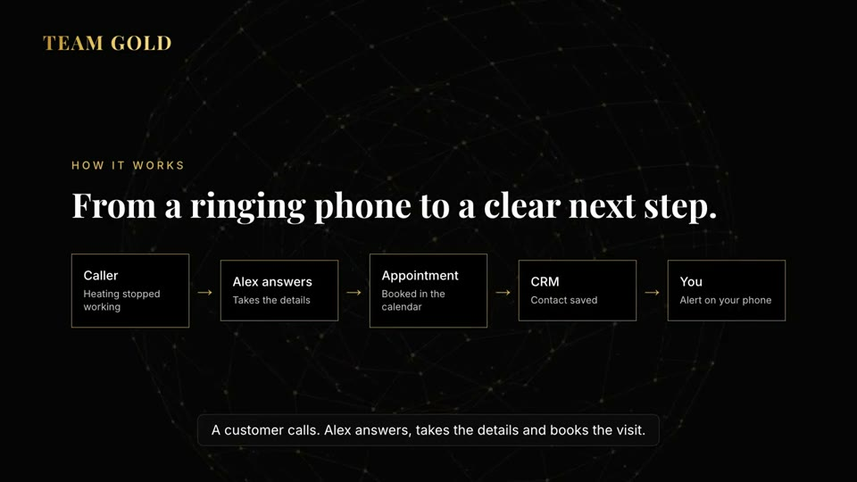
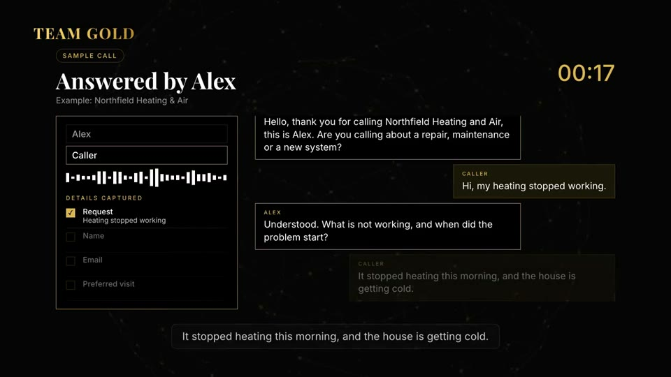
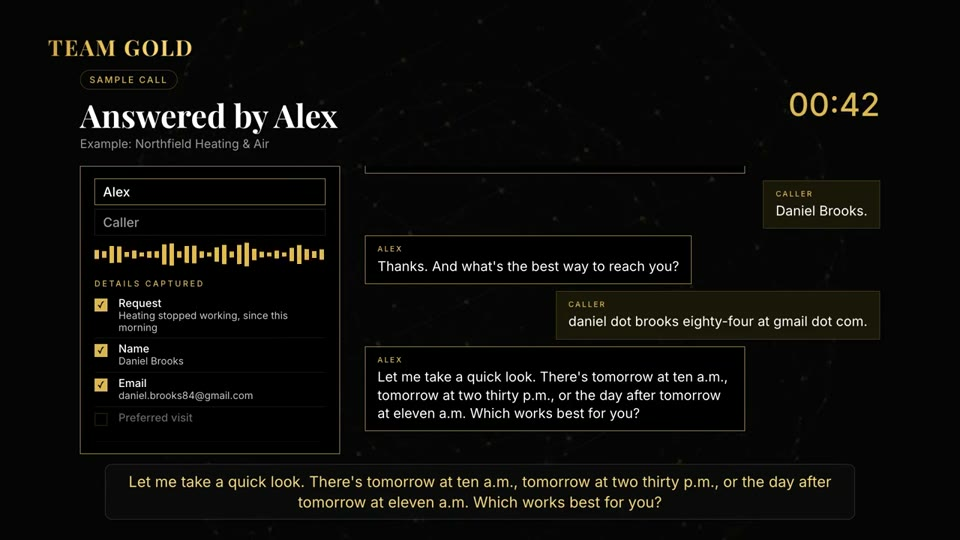

<!-- Hands-on Fallstudie: KI-Telefonassistent "Alex" und automatisch erzeugte Demo-Videos. Kein Quellcode, nur Ablauf, Medien und Lehren. -->
# AI Voice Agent + Demo Videos — hands-on

An AI receptionist that answers the phone for small trade businesses (heating, plumbing, roofing, solar), takes the job details, and books an appointment. Plus the pipeline I used to turn it into polished demo videos without a video editor.

This is a **case study of how it came together**, not a deployable product. All company names in the demos are fictional. No customer data, keys or phone numbers are in this repo.

**▶ [Short call demo (1:37)](media/call-demo-short.mp4)** · **▶ [Full walkthrough (3:00)](media/full-demo.mp4)**
Live version with all four trades in English and German: [teamgoldllc.de/voice-agent](https://teamgoldllc.de/voice-agent)

## What it does

A caller reaches the assistant, Alex. Alex:

1. Greets the caller in the name of the business and asks what it is about (repair, maintenance, new system).
2. Asks what is wrong and since when, so the technician arrives prepared.
3. Takes name and contact details, and repeats them back.
4. Offers appointment slots (sample slots in the demo), confirms the pick, and closes the call.

| Opening | Diagnosis | Booking | Confirmation |
|---|---|---|---|
|  |  |  |  |

### Listen

| Sample | File |
|---|---|
| Greeting, heating company (EN) | [en-greeting-hvac.mp3](audio/en-greeting-hvac.mp3) |
| Greeting, roofing company (EN) | [en-greeting-roofing.mp3](audio/en-greeting-roofing.mp3) |
| Offer, heating company (EN) | [en-offer-hvac.mp3](audio/en-offer-hvac.mp3) |
| Greeting, heating company (DE) | [de-greeting-hvac.mp3](audio/de-greeting-hvac.mp3) |

Voices are synthetic (text-to-speech). The caller in the videos is a placeholder voice.

## How it came together

1. **Write the conversation first.** Every line Alex says is a short script per trade. The same flow works for all four businesses; only the company name and service words change.
2. **Generate the voice.** Each line is rendered once as an audio clip, then checked by transcribing it back and comparing it to the script. A clip that does not match gets re-rendered.
3. **Build the video as a web page.** Scenes are plain HTML with animation (HyperFrames), timed to the audio clips. Change a line, rebuild, and the video follows.
4. **Render, then test on the real site.** The finished videos are compressed and embedded on the website with a swipeable player (arrow keys, fullscreen).
5. **Make it work in two languages.** The German version has its own text and its own German voice.

## What I learned

- A phone assistant lives or dies on the **first five seconds** and on **repeating details back**. Both are cheap to build.
- **Keep the word "demo" out of the script.** I removed it from the reception lines and used fictional businesses, so the call plays like a real one.
- **Verify generated audio automatically.** Round-tripping each clip through transcription flags clips that drift from the script before a human has to listen.
- **Video as code** makes revisions trivial. Copy changes need a rebuild, not an editing session.

## More in this repo

- [The reception demo](docs/reception-demo.md): a guided call anyone can try in the browser, with fixed recordings and local speech recognition.
- [Freeing up a full Mac](docs/mac-storage-cleanup.md): where video work eats the disk, and how I got from 4 GB to 65 GB free.

## Stack, briefly

Telnyx voice and AI assistant · text-to-speech voices · HyperFrames (HTML to video) · ffmpeg · React/Vite site on Vercel.

## About

Built by [Atakan](https://github.com/Atakan-24) for [Team Gold](https://teamgoldllc.de). More work: [portfolio](https://atakan-24.github.io/) · [CRM case study](https://github.com/Atakan-24/team-gold-crm-showcase).
